  

## ◇ About

> **Heritage deserves a product-grade archive. Fintech wins on trust. Commerce has to run every day.**

I'm a web & mobile engineer based in **Tripoli, Libya**, leading technology across the **Master Libya** ecosystem.
I design and ship digital products end to end — from architecture and APIs to pixel-perfect, Arabic-first interfaces —
for clients across Libya and remotely worldwide.

## ◇ Selected Work

## ◇ Toolkit

## ◇ GitHub at a Glance

<picture>
  <source media="(prefers-color-scheme: dark)" srcset="https://raw.githubusercontent.com/ahmednaffati2004/ahmednaffati2004/output/snake-dark.svg"/>
  
</picture>

 

<i>“Digital solutions that move with your ambition.”</i>

